# Benchmarks

Tous les graphiques sont produits par les scripts de [src/Graphique/](../src/Graphique/), à partir des fichiers de [configs/benchmarks/](../configs/benchmarks/). Les résultats bruts (historique epoch par epoch, métriques, matrices de confusion) sont dans `doc/benchmarks/<campagne>/results.json`. L'analyse et les décisions sont dans [hyperparametres.md](hyperparametres.md).

Sur les courbes d'apprentissage, le trait **plein** représente la validation et les **pointillés** l'entraînement, dans la même couleur pour un même modèle. Tous les scores en barres sont mesurés sur le jeu de **test**, jamais vu pendant l'entraînement.

## Réseau final

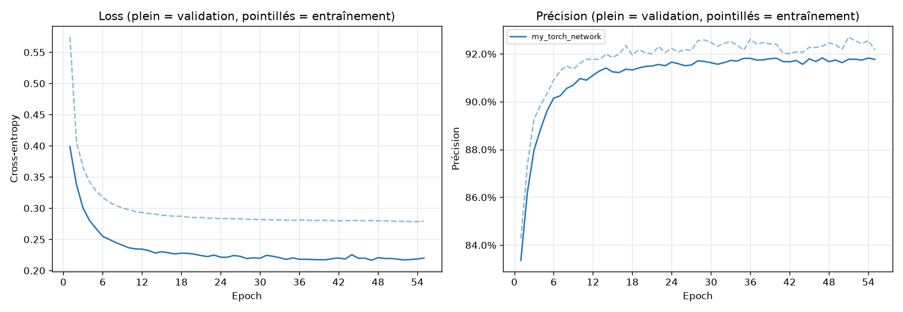

La loss de validation se stabilise sans remonter : il n'y a pas de surapprentissage. La loss d'entraînement est plus haute, parce qu'elle est mesurée avec le dropout actif.

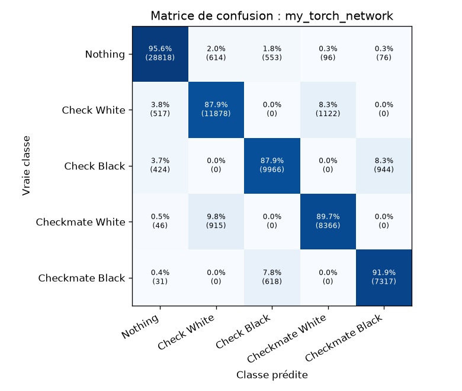

Les couleurs ne sont jamais confondues. Les erreurs restantes portent sur Check ↔ Checkmate et sur Nothing ↔ Check.

**Test : 91.76 % de précision, 90.25 % de F1 macro.**

## De la référence au réseau final

| Étape | Test acc | F1 macro |
|---|---|---|
| v0 : 256-128, Adam, sans régularisation | 83.27 % | 81.30 % |
| + dropout 0.2 + L2 0.0001 | 88.09 % | 86.38 % |
| + 60 epochs maximum | 88.77 % | 87.12 % |
| + données augmentées ×4 | 90.42 % | 88.89 % |
| + 512-256, 100 epochs maximum, patience 8 (**final**) | **91.76 %** | **90.25 %** |

## Série 1 : un facteur à la fois

### Régularisation : le facteur le plus important
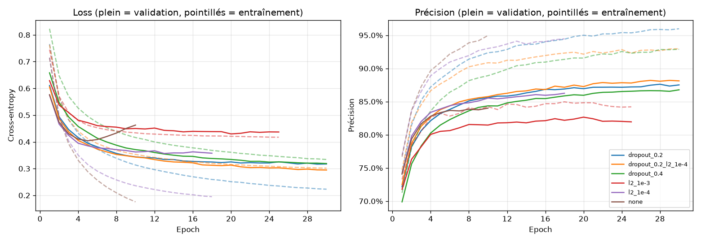
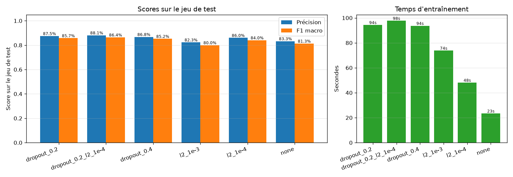

Sans régularisation (`none`), la loss de validation remonte dès l'epoch 5. Avec le dropout, elle continue de baisser jusqu'à l'epoch 30.

### Optimiseur
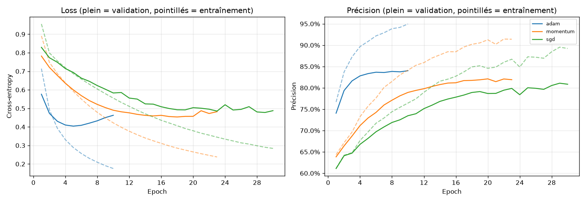
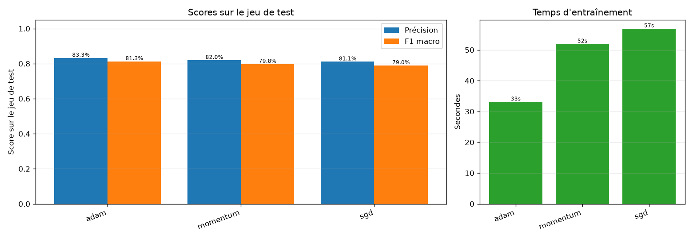

### Learning rate
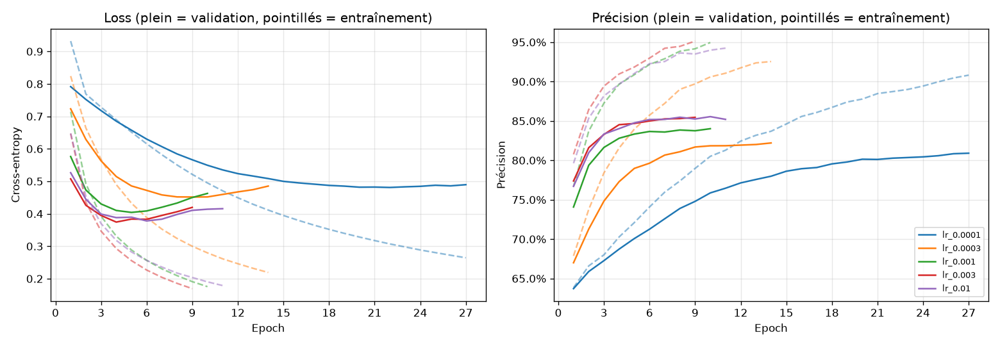
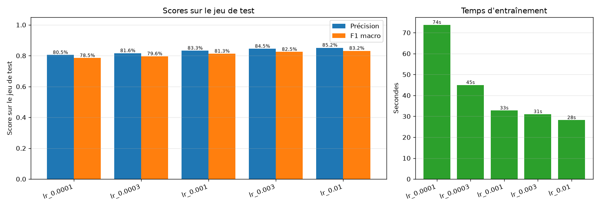

### Taille de batch
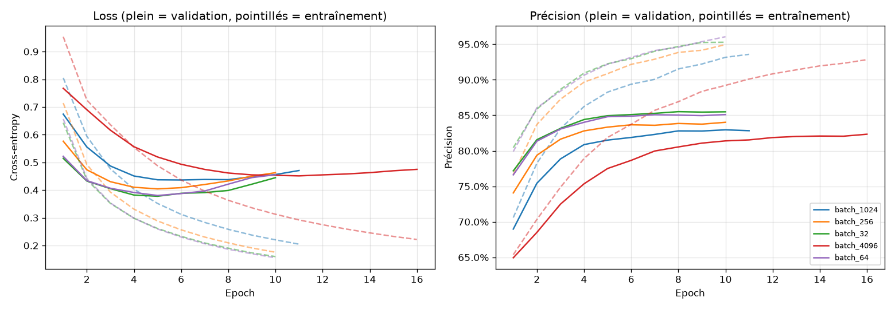
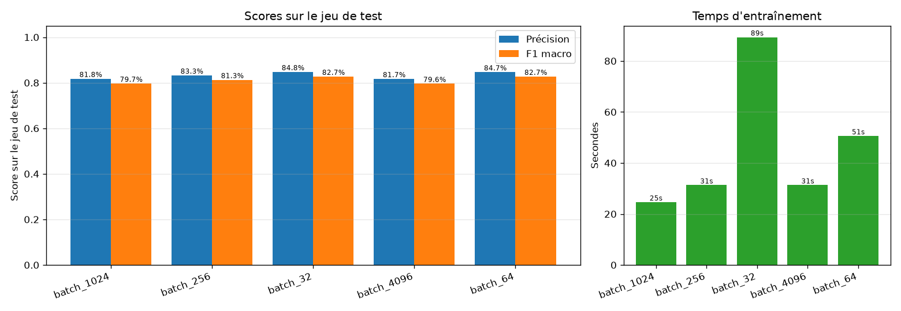

### Architecture
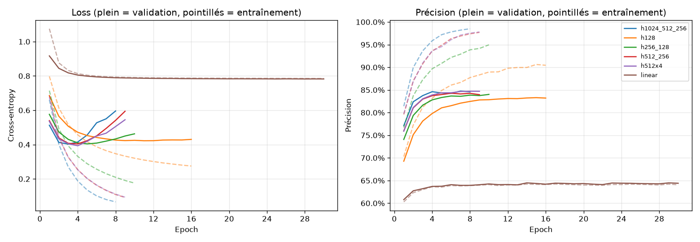
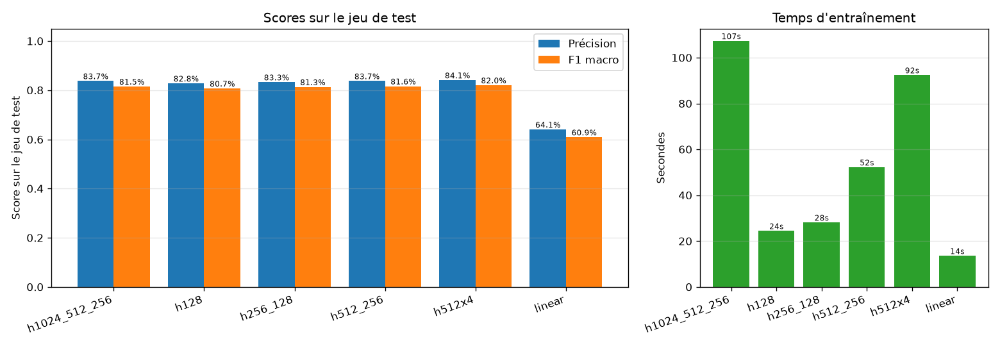

Le modèle linéaire plafonne à 64 % : le problème n'est pas linéairement séparable.

### Activation
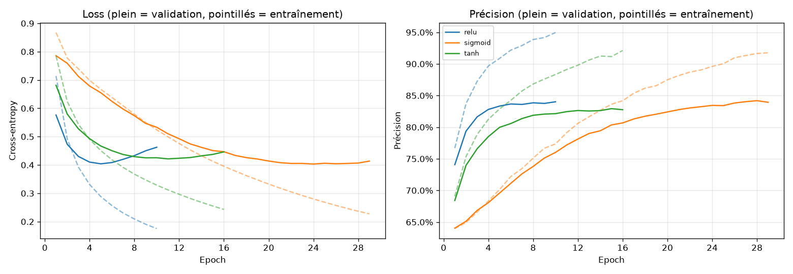
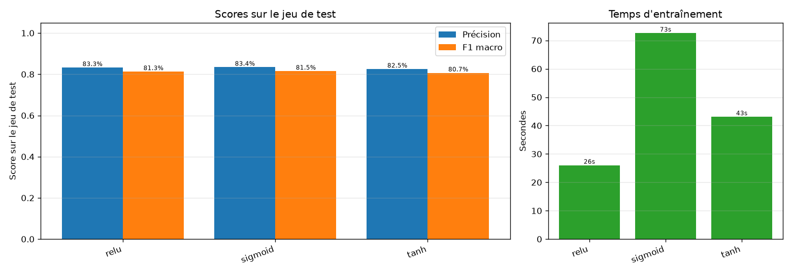

### Initialisation
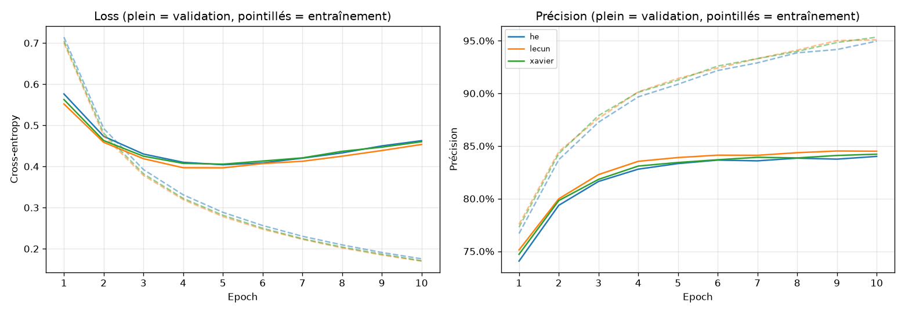
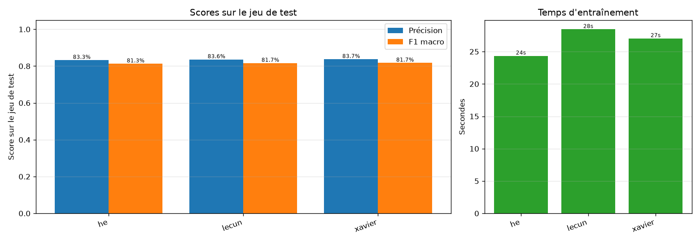

### Décroissance du learning rate
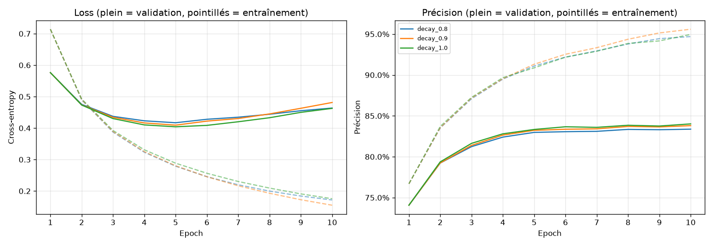
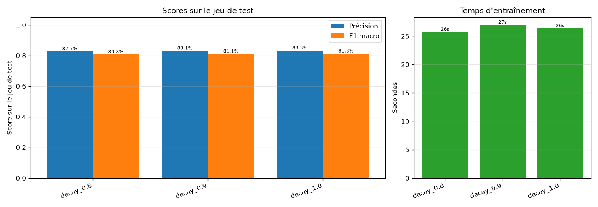

## Série 2 : combinaisons et alternatives

### Combinaisons
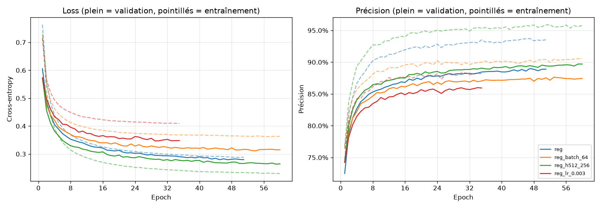
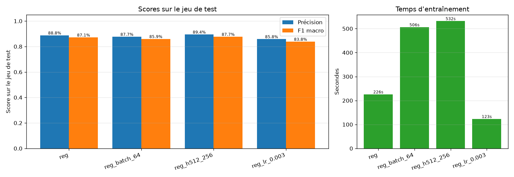

### Augmentation de données
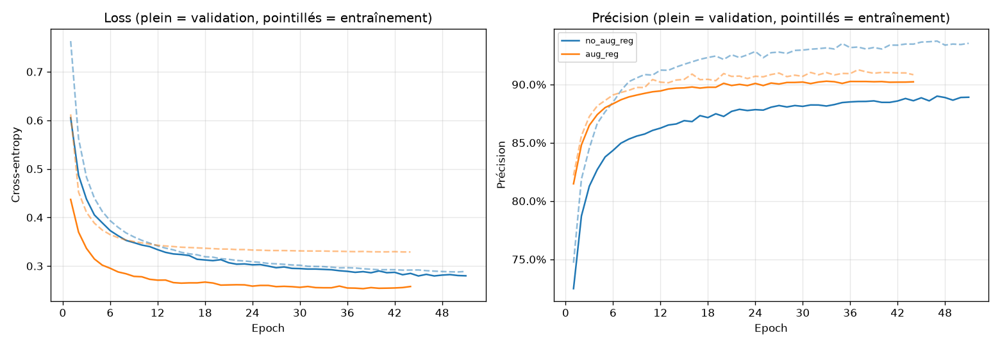
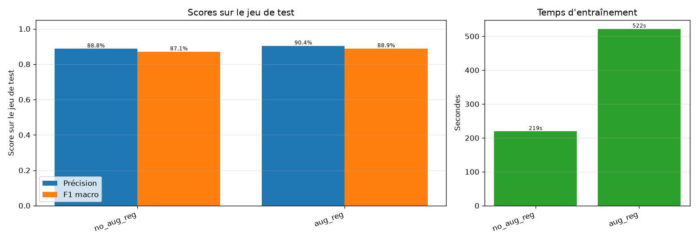

### Encodage de l'entrée
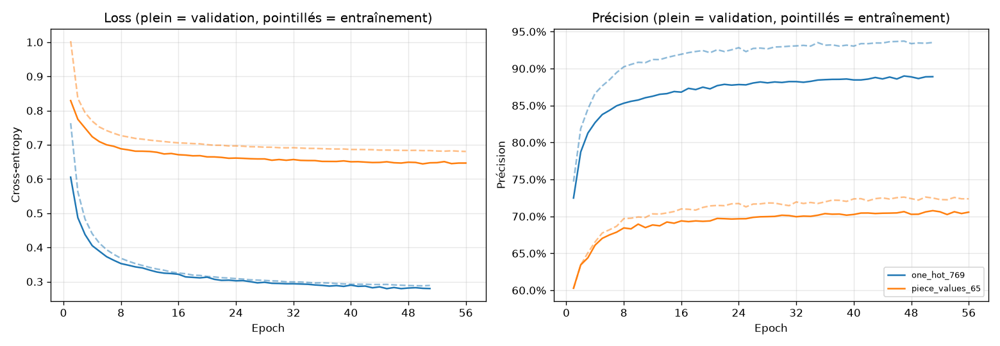
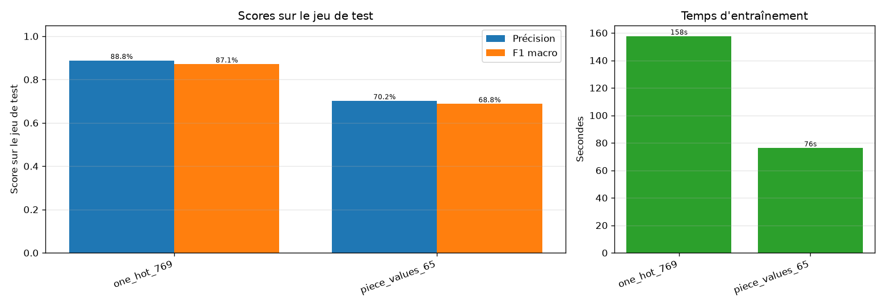

## Parallélisme

### Lecture du dataset (multiprocessing)
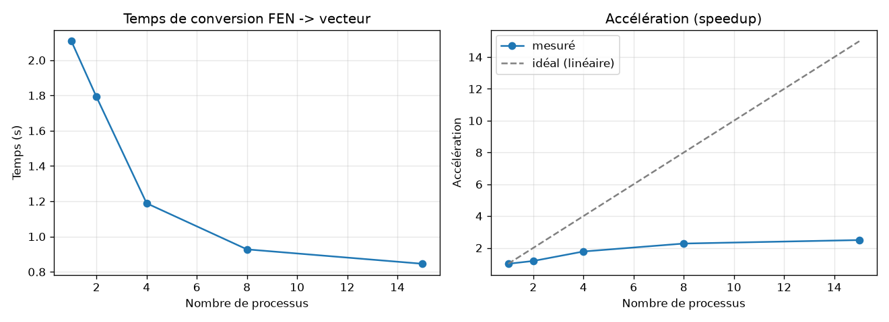

| Processus | 1 | 2 | 4 | 8 | 15 |
|---|---|---|---|---|---|
| Temps (650 718 FEN) | 2.11 s | 1.79 s | 1.19 s | 0.93 s | 0.85 s |
| Accélération | ×1 | ×1.18 | ×1.77 | ×2.27 | ×2.48 |

L'accélération est loin d'être linéaire. Chaque processus renvoie son morceau de tableau au processus principal, ce qui demande de le sérialiser et de le copier (environ 500 Mo au total). Ce transfert, plus le démarrage des processus, ne se parallélise pas (loi d'Amdahl).

### Entraînements simultanés (recherche d'hyperparamètres)
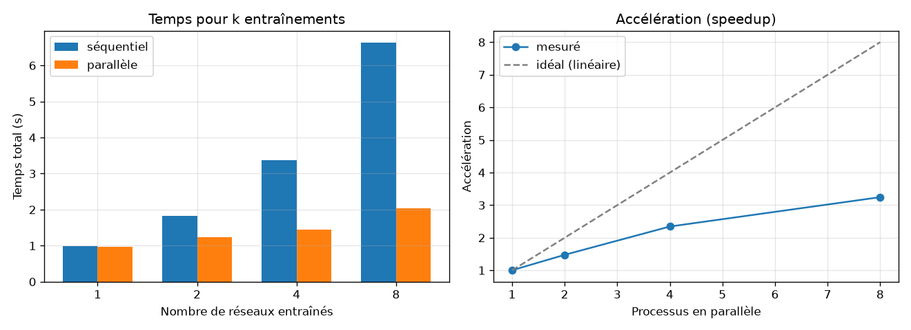

| Réseaux entraînés | 1 | 2 | 4 | 8 |
|---|---|---|---|---|
| L'un après l'autre | 1.0 s | 1.8 s | 3.4 s | 6.6 s |
| En même temps (k processus) | 1.0 s | 1.2 s | 1.4 s | 2.0 s |
| Accélération | ×1 | ×1.48 | ×2.34 | ×3.24 |

C'est ce parallélisme qu'utilise [benchmark.py](../src/Graphique/benchmark.py) pour comparer plusieurs configurations. Mesure : une epoch de 100 000 exemples par réseau, avec la config finale.

**Threads du calcul matriciel :** nous avons aussi mesuré le temps d'une epoch avec 1, 2, 4, 8 et 15 threads BLAS (`VECLIB_MAXIMUM_THREADS`). Il est **identique** dans tous les cas : 1.59 s pour 200 000 exemples. Sur Apple Silicon (ici un M5 Pro), numpy utilise le framework Accelerate, qui fait les produits matriciels sur une unité de calcul matriciel dédiée et ne profite pas de threads supplémentaires. Pour gagner du temps sur cette machine, il faut donc lancer plusieurs processus, pas multiplier les threads.
